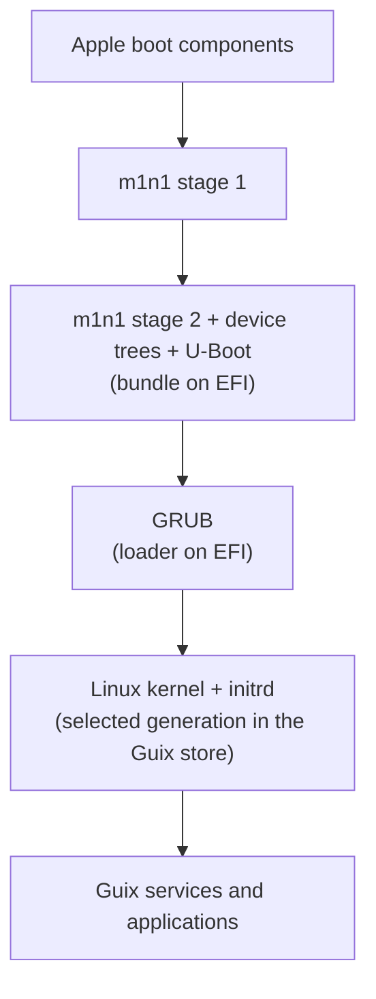
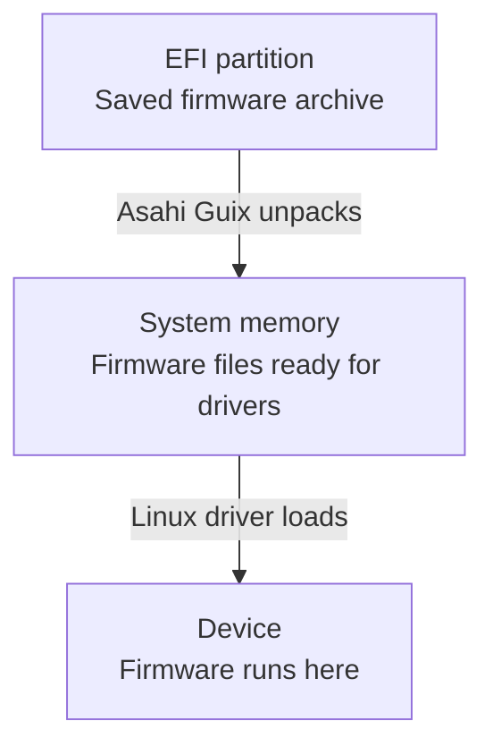
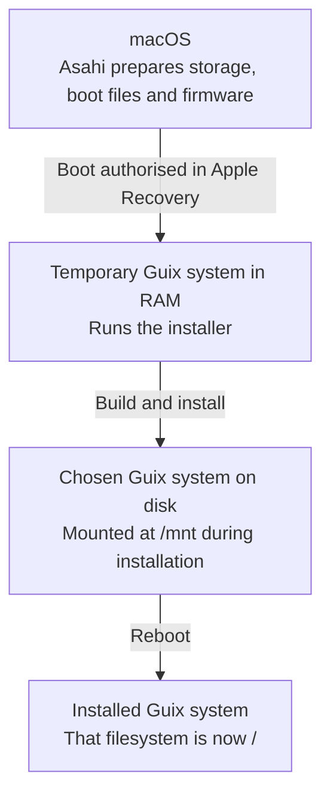

<!-- SPDX-FileCopyrightText: 2026 Harish Narayanan -->
<!-- SPDX-License-Identifier: GPL-3.0-or-later -->

# How it fits together

## A Guix system on Apple hardware

Guix gives us a way to describe an operating system in Scheme and build
it from that description. Asahi provides the support that lets Linux use
Apple’s hardware. Hello Guix connects these ideas, making the Mac’s
hardware requirements part of the system we describe. Here, we can look
more closely at where the pieces come from and how they work together,
from the system we describe to the one we run.

### What the parent projects provide

Hello Guix draws on three projects, each with a different role:

- **[Asahi Linux][asahi]** provides Linux hardware support for Apple Silicon
  and an installer that prepares the Mac to boot another operating system.
- **[Asahi Guix Channel][asahi-channel]** makes Asahi’s work available as
  Guix packages, services and image builders.
- **[GNU Guix][guix]** turns a system declaration into packages, accounts
  and services. Its installer asks the questions that produce that
  declaration.

## Describing and building the system

### The hardware adapter

Your configuration file is a Scheme program. When Guix evaluates it, the
result is an `operating-system` value describing the system to build.
Hello Guix’s `with-asahi-hardware` takes that value and returns another
with the Mac’s hardware support included. It selects the Asahi kernel,
firmware services and audio integration while preserving your accounts,
applications and storage settings.

Guix then builds the system from this modified description in the usual
way. Using the same function during installation and later reconfiguration
keeps the hardware support part of each system we describe.

### The files Guix builds

Guix turns this description into a set of files we can install. It creates
a directory in `/gnu/store` with configuration and startup files, and links
to the kernel and programs that make up our system. It also includes a
small initial environment called an *initrd*. Linux runs this in memory
to find and mount the main filesystem before starting the installed system.

The Mac also needs a way to start Linux and tell it about the hardware.
Hello Guix uses the Asahi Guix Channel’s builders to assemble the pieces
for this into a *boot bundle*, kept in the `asahi-boot/` subdirectory.
These are the [m1n1][m1n1] and [U-Boot][u-boot] startup programs, together
with *device trees* that describe the hardware. The device trees come from
the system’s kernel, keeping the bundle matched to it. We’ll see how these
pieces work together [during startup](#from-built-files-to-a-running-system)
below.

When we install or reconfigure, Guix records the built system as a
*generation*. Hello Guix also keeps the configuration and supporting
Scheme files in `configuration-source/`, so each generation retains the
description used to build it. The [configuration guide](configuration.md)
explains how to use these files and select newer software versions.

## From built files to a running system

Once the Guix system is installed, we can follow how the Mac starts it.
This means connecting Apple’s boot environment to Linux, then making the
hardware available to the services and applications we chose.

### From Apple’s boot environment to Linux

When we turn on the Mac, Apple’s own startup code runs first. To start
Linux, we need a program that can take over from that code and prepare
the hardware in the way Linux expects. This is m1n1’s role.

[During installation](#how-installation-creates-that-system), we use Apple
Recovery, the Mac’s recovery environment, to authorise m1n1 as a startup
program. Replacing that copy later requires returning to Recovery. To
avoid this for routine updates, Asahi uses it as a first stage that loads
a second copy from disk. This second stage can be updated from Linux.

The second stage lives in the boot bundle we built earlier. We place a
copy on the EFI System Partition, a separate area for boot files.
m1n1’s first stage can read this partition, but not the filesystem
containing our Guix store.

The arrows below show the startup sequence. The labels on the boot bundle,
GRUB and kernel also show where their files are stored:



Once loaded, m1n1 prepares the hardware and U-Boot provides a standard
boot interface called [UEFI][uefi]. This gives GRUB access to disks, the
screen and keyboard, enough to let us choose a generation and load its
kernel and initrd. m1n1 and U-Boot provide this Mac-specific support as
free software, so GRUB can work in the usual way. Asahi’s
[interoperability guide][asahi-interop] explains the arrangement.

This also helps us see why building a generation is only part of an
update. By the time GRUB offers us a choice, the Mac has already loaded
the bundle from EFI. In 0.1, we explicitly install the matching bundle
there as part of [updates and
rollback](configuration.md#update-your-system). The active copy appears in
Linux at `/boot/efi/m1n1/boot.bin`.

Apple’s firmware and boot policy sit beneath all of this, outside Guix’s
system generations.

### Making firmware available to drivers

Booting Linux gives us the kernel and its drivers, but some devices need
software running inside them too. The Wi-Fi controller, for example,
needs a small program called *device firmware*. Its Linux driver is free
software, while the firmware is proprietary.

While running in macOS, Asahi’s installer extracts the firmware from
Apple’s restore files and packages it on EFI for Linux to use. EFI gives
the installer somewhere to leave these files for Linux to pick up after
we reboot.

At startup, programs in the [initrd][initrd] mount the main filesystem.
Guix then uses the Asahi Guix firmware service to unpack the saved files
into memory and tell Linux where to find them, before starting the
services that load the device drivers. A driver can then load the firmware
into its device:



This arrangement serves drivers loaded after the main filesystem is
available. Devices that need firmware within the initrd need it sooner.
That earlier handoff still needs integration and testing in Hello Guix.
The installation guide describes the [hardware tested so far][tested].

### Starting services and user sessions

Once the drivers can use the hardware, services make it available to
applications. System services start as the computer boots, including
`speakersafetyd`, which protects the Mac’s speakers from overheating.
Per-user services run under your account. The PipeWire audio server, for
example, mixes and routes your applications’ sound.

When we describe the system, `with-asahi-hardware` adds the Asahi services
needed by the Mac. Guix’s usual service machinery starts and manages them.
This explains why the function sometimes changes both system and
per-user services: hardware support can extend into your session while
applications continue to use standard interfaces. The
[configuration guide](configuration.md#audio-and-guix-home) explains how
those two parts are declared.

## How installation creates that system

We’ve followed how an installed Guix system starts and uses the Mac’s
hardware. But on a Mac that only has macOS, we first need a way to run
Guix’s installer. We do this by booting a temporary Guix system, which
builds the system we will keep.



### Preparing the Mac

In macOS, Hello Guix runs Asahi’s installer and supplies the temporary
Guix system in a file called a *setup image*. Asahi prepares the disk
partitions and boot environment, and saves the device firmware.
Authorising the new environment in Apple Recovery then allows the Mac to
start Guix.

Hello Guix saves the prepared partitions’ identifiers and sizes on EFI.
After booting Linux, Hello Guix uses these details to find and check the
destination, so Guix installs into the space set aside in macOS.

### Booting a temporary Guix system

When the Mac first boots Guix, it starts the temporary system supplied
in our setup image. The image lives on EFI, which will also hold the
finished system’s bootloader. We need to install that bootloader and
later remove the setup image, while keeping the installer running.

We do this by moving setup into memory. During boot, the initrd copies
the image into RAM and unmounts EFI. The installer can then keep working
while the files it started from are changed or removed.

### Creating the system that will take over

With setup running in memory, we can begin creating the new system on
disk. Setup’s files appear in a directory tree starting at `/`. We mount
the prepared disk filesystem at `/mnt`, making it accessible within that
tree. Files written there belong to the system we are installing.

Guix’s installer turns our answers into a Scheme declaration. Hello Guix
supplies the prepared storage settings and passes the declaration through
`with-asahi-hardware`. Guix then installs the resulting system using its
usual installation machinery.

Guix reuses packages already available in setup and places new downloads
and builds on the destination disk. The installed system receives all
the packages it needs in its own store.

Guix installs GRUB for the new system, while Asahi’s boot bundle and device
firmware remain on EFI. The new system keeps our configuration, channel
versions and supporting Scheme files. Once the temporary setup files are
removed, we can reboot. The filesystem we filled at `/mnt` becomes `/`,
and we are running the system we described.

## Where the code lives

So far, we’ve followed how a system description becomes a running Mac.
Reading the source lets us see how those ideas work in practice. The map
below shows where the pieces live, so you can choose a part that interests
you and begin exploring.

```text
hello-guix/
├── src/hello-guix/
│   ├── installer/
│   │   ├── macos/             # Download, check and launch Asahi preparation
│   │   └── linux/             # Run the Guix installation flow
│   └── system/                # Hardware, audio, boot bundles and saved source
├── packaging/
│   ├── guix/                  # Channels, packages, setup system and images
│   └── macos/                 # Runtime sources and upstream notices
├── patches/                   # Changes to the three parent projects
├── scripts/                   # Source preparation and release assembly
├── tests/                     # Local checks and disposable VM tests
├── docs/                      # This handbook
├── LICENSES/                  # Licence texts
├── NOTICE                     # Installer licences and sources
└── build/                     # Generated files, outside version control
```

A good first stop is `with-asahi-hardware` in [hardware.scm][hardware].
It shows how the Mac’s hardware support becomes part of a Guix system.
The table below points to the other parts of the design.

| Part of the design | Start with |
|---|---|
| Hardware support in the declaration | [hardware.scm][hardware] and [audio.scm][audio] |
| Building the matching boot bundle | [boot.scm][boot] |
| Installing a boot bundle | [boot-files.scm][boot-files] |
| Saving each generation’s configuration sources | [configuration-retention.scm][configuration-retention] |
| Download and macOS preparation | [bootstrap.sh][bootstrap], then [launch.sh][launch] |
| Setup system and RAM boot | [setup.scm][setup], then [ram-boot.scm][ram-boot] |
| Guix’s questions and generated configuration | [installer-ui.scm][installer-ui] and [configuration.scm][configuration] |
| Destination checks | [target.scm][target] |
| Installation and completion | [install.scm][install] and [installation-files.scm][installation-files] |

The patch directories explain the changes to
[Guix’s installer][guix-patches], [Asahi’s installer][asahi-patches] and the
[Asahi Guix image builder][image-patches]. Generated copies of these
sources stay in `build/`. Each patch can be reviewed or offered upstream
on its own. The [development guide](development.md) continues with
building and testing the project.

[guix]: https://guix.gnu.org/
[initrd]: https://guix.gnu.org/manual/en/html_node/Initial-RAM-Disk.html
[asahi]: https://asahilinux.org/
[asahi-channel]: https://codeberg.org/asahi-guix/channel
[asahi-interop]: https://asahilinux.org/docs/platform/open-os-interop/
[m1n1]: https://asahilinux.org/docs/sw/m1n1-user-guide/
[u-boot]: https://docs.u-boot.org/en/latest/board/apple/m1.html
[uefi]: https://en.wikipedia.org/wiki/UEFI
[tested]: installation.md#what-has-been-tested
[bootstrap]: ../src/hello-guix/installer/macos/bootstrap.sh
[launch]: ../src/hello-guix/installer/macos/launch.sh
[setup]: ../src/hello-guix/installer/linux/setup.scm
[ram-boot]: ../src/hello-guix/installer/linux/ram-boot.scm
[installer-ui]: ../packaging/guix/systems/installer-ui.scm
[configuration]: ../src/hello-guix/installer/linux/configuration.scm
[target]: ../src/hello-guix/installer/linux/target.scm
[install]: ../src/hello-guix/installer/linux/install.scm
[installation-files]: ../src/hello-guix/installer/linux/installation-files.scm
[hardware]: ../src/hello-guix/system/hardware.scm
[audio]: ../src/hello-guix/system/audio.scm
[boot]: ../src/hello-guix/system/boot.scm
[boot-files]: ../src/hello-guix/system/boot-files.scm
[configuration-retention]: ../src/hello-guix/system/configuration-retention.scm
[guix-patches]: ../patches/gnu-guix-installer/README.md
[asahi-patches]: ../patches/asahi-macos-installer/README.md
[image-patches]: ../patches/asahi-guix-image-builder/README.md
